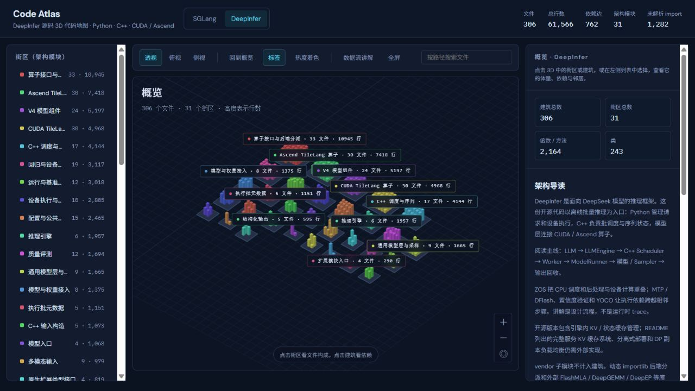

# DeepInfer 源码架构分析

分析对象为 `D:\code\deepinfar`，仓库内项目名为 **DeepInfer**。来源：`main`，提交 `8b16149741a4935e1dec8cea27853f273b374c5b`，2026-10-20 的本地干净检出。本文依据本地 README、源码定义及静态依赖分析；没有运行推理或性能基准。

## 核心结论

DeepInfer 将离线批量推理组织为 **Python 生命周期管理 + C++ 批调度 + 设备模型执行**。入口是 `deepinfer/entrypoints/llm.py` 的 `LLM`；核心引擎是 `deepinfer/engine/llm_engine.py` 的 `LLMEngine`；调度器的实现位于 `csrc/engine/scheduler.hpp`，通过 `deepinfer._C.engine` 接入 Python。只看 Python 包会漏掉调度实现，只看 C++ 又看不到 Worker 和模型算子之间的配合，因此地图同时纳入两层及其类型接口。

本地 README 将此版本定位为离线推理核心，支持 DeepSeek-V4.1-Flash，并列出 NVIDIA SM100、Ascend 950 两种目标设备。引擎内已有 KV / 状态缓存管理；完整服务所需的 KV 缓存系统、VE/Prefill/Decode 分离式部署及 DP 副本负载均衡仍需额外实现。这两个层面的缓存不能混为一谈。

## 静态快照

| 指标 | 结果 |
| --- | ---: |
| 源码文件 | 306 |
| Python 实现 / Python 类型桩 / C++ | 269 / 4 / 33 |
| 架构街区 | 31 |
| 总行数 / 近似代码行 | 61,566 / 51,199 |
| Python import / 本地 C++ include / 显式扩展绑定 | 708 / 49 / 5 |
| Python 与类型桩的类、函数和方法符号 | 2,193 |
| 同文件符号调用边 | 1,871 |
| 未解析 Python import / 外部或未解析 include | 1,282 / 148 |
| 读取 / 解析错误 | 0 / 0 |

统计覆盖 `deepinfer`、`deep_cluster`、`csrc`、`examples`、`tests`、`eval` 内的 `.py`、`.pyi` 与 C/C++ 源码。`vendor` 子模块、构建脚本、`setup.py`、文档和媒体文件不计入建筑。未解析 import 多数为标准库、第三方库或无法映射的符号来源，不能据此判断代码缺陷。近似代码行排除空行与注释；Python 文档字符串仍计入。

## 模块地图

| 模块 | 主要职责 | 建议入口 |
| --- | --- | --- |
| entrypoints | 将输入与采样参数提交给引擎，收集结果 | `deepinfer/entrypoints/llm.py` |
| engine | 请求状态、调度迭代、Worker 协作、输出回收 | `deepinfer/engine/llm_engine.py` |
| csrc/engine | 原生批调度、序列、缓存块与采样准备 | `csrc/engine/scheduler.hpp`、`sequence.hpp`、`block_manager.hpp` |
| worker | 前向/后处理/采样协调、设备图、本地缓存 | `deepinfer/worker/worker.py`、`model_runner.py`、`cache_engine.py` |
| models/v4_modules | 模型装配、注意力、MoE、Engram 与跨层共享 | `deepinfer/model_executor/models/v4_modules/builder.py` |
| models/mtp | DFlash 草稿生成路径 | `deepinfer/model_executor/models/mtp/dflash.py` |
| layers | 采样、通用层与注意力接口 | `deepinfer/model_executor/layers/sampler.py` |
| tilelang_ops | 算子接口及 CUDA/Ascend 后端 | `deepinfer/model_executor/layers/tilelang_ops/ops.py` |
| parallel_utils / eplb | 进程组、通信、上下文并行与专家负载均衡 | `parallel_state.py`、`eplb/policy.py` |
| ve / structure_output | 多模态输入、语法约束与 token 掩码 | `deepinfer/ve/multimodal_processor.py`、`deepinfer/structure_output/compiler.py` |
| deep_cluster | 硬件检测、NUMA 与进程绑定 | `deep_cluster/topology/bind.py` |

## 一次请求的阅读路线

1. `LLM.generate` 接收提示词或 token，`_add_request` 创建请求并在需要时分词；`_run_engine` 负责循环推进和收集输出。
2. `LLMEngine.step` 调用 `self.scheduler.schedule`，组织调度结果和 Worker 执行。
3. `Scheduler` 在 C++ 中维护序列与批，选择 prefill / decode，协调缓存块和可变长度 MTP 的元数据。
4. `Worker.execute_model_step` 协调前向、后处理、采样；`ModelRunner` 的主模型执行与采样方法连接具体模型。
5. `DeepseekModel` / `DeepseekForCausalLM` 进入 V4 模型组件；注意力和 MoE 等模块进一步使用设备算子与通信。
6. `ops.py` 根据平台动态导入后端，CUDA / Ascend 目录提供实现；FlashMLA、DeepGEMM、DeepEP 等依赖位于本图范围之外。
7. `Sampler` 结合 logits 和采样参数生成 token，推测路径需要验证草稿并更新状态。
8. 引擎处理完成状态和输出，`DeferredRelease` 延迟释放资源，入口收集 `RequestOutput` 并按需解码；未完成请求继续迭代。

这是设计上的阅读顺序。ZOS 会把相邻步骤的 CPU 调度、后处理与设备前向重叠，MTP / DFlash 和 YOCO 又改变输入长度和缓存共享关系，所以不能把这条路线当成严格串行的实际调用时序。

## 值得重点阅读的位置

**算子是代码体量中心。** 通用算子接口目录 33 文件 / 10,945 行，Ascend 后端 30 / 7,418，CUDA 后端 30 / 4,968；三者合计 23,331 行，约占所分析代码的 37.9%。这里包含 TileLang 内核、元数据准备和缓存操作；目录行数不是运行耗时，无法直接据此推断性能瓶颈。

**调度和状态边界值得先理解。** `scheduler.hpp` 为 1,329 行，`llm_engine.py` 为 1,029 行，`cache_engine.py` 为 978 行。阅读 ZOS 时，结合 `worker/zos_status.py` 的 `WorkerStepState` / `MetadataZOS`、`Worker` 回调与 `DeferredRelease` 看相邻轮次的数据和资源生命周期，比单独追某个 `forward` 更容易理解异步设计。

**静态依赖的枢纽并不都代表执行核心。** 图中 `deepinfer/__init__.py` 被 67 个文件导入，部分原因是它导出 `envs`、`AttrDict` 等公共入口；`logger.py` 被 30 个文件导入；动态分派入口 `ops.py` 被 28 个文件导入，`parallel_state.py` 被 23 个文件导入，原生引擎类型桩被 17 个文件导入。这些数值衡量静态耦合，不能解释为运行次数或耗时。

**平台差异分为几层。** `platform.py`、`deep_cluster/hardware` 和 `npu_ops` 管理能力检测与适配；`tilelang_ops/ops.py` 选择设备算子目录；原生构建还选择平台对应实现。地图保留 CUDA 与 Ascend 两侧文件，表示可用源码结构，不代表运行时同时加载两套后端。

## 地图如何表达，以及边界

街区按最长架构目录前缀划分，避免把整个 `model_executor` 挤成一个街区。建筑对应真实文件，高度按行数对数映射；中文名称可帮助定位职责，检查器保留完整源路径。每个文件附导读或根据实际定义归纳的说明，关键定义可进入符号楼层。

Python 和 `.pyi` 用标准库 AST 解析；`.pyi` 的楼层是接口声明。C++ 只统计行数和源码中可解析到本地文件的 `#include`，不统计 C++ 类/函数指标，也不生成符号楼层。扩展绑定边从 `_C` 类型桩指向已核对的 `pybind` 或设备工具注册入口。这些边用于连接语言边界，不是逐符号调用边。`cuda_utils.pyi` 同时连接 `cuda_utils.cpp` 与 `asc_utils.cpp`，表示构建时按平台择一的替代关系。

静态导入包含条件分支与 `TYPE_CHECKING` 内的导入，不判断某次执行是否激活。`importlib` 动态装配、第三方内核、宏展开、虚调用、注册表和跨文件函数调用不在依赖图内。同文件调用按裸名字近似匹配，会混淆不同类的同名方法。性能结论需要另做 trace、设备 profiling 和基准验证。

## 重新生成与查看

在 Code Atlas 工程中运行 `npm run graph:deepinfer`，或用 `python tools/extract_deepinfer.py --root <仓库路径>` 后运行 `node scripts/sync-graph.mjs deepinfer`。源码只读，不会导入或执行待分析项目。数据单独保存到 `public/deepinfer/graph.json`，与 SGLang 的当前图和基线互不覆盖。

打开顶部 **DeepInfer**，或使用 `?project=deepinfer`。右侧概览有架构导读；点击建议阅读入口可定位建筑；“数据流讲解”可按 9 步切换；Python 文件可展开为符号楼层。文件深链接示例：`?project=deepinfer#/f/deepinfer%2Fengine%2Fllm_engine.py`。
